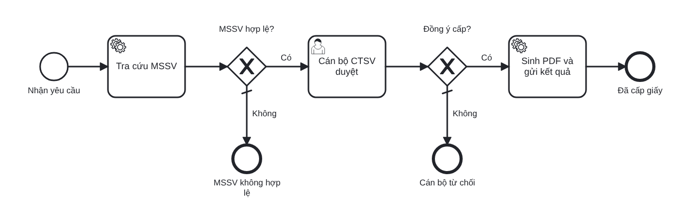

# Student Certificate Automation

Modeling and automating the UET student confirmation certificate process with Service Blueprint, BPMN and Camunda 8.

Bài tập lớn môn Khoa học dịch vụ – Nhóm 16: mô hình hóa và tự động hóa quy trình **cấp giấy xác nhận sinh viên** (UET) trên Camunda 8.

| Thư mục | Nội dung |
| --- | --- |
| `bpmn/as-is/` | BPMN quy trình hiện tại (mô tả, không chạy) + ảnh PNG – Task #3 |
| `bpmn/demo/` | Process mẫu chạy được trên Camunda – Task #4 |
| `forms/` | Camunda Forms dùng cho user task |
| `src/` | Python: deploy, khởi tạo instance, job worker, xuất dữ liệu KPI |
| `docs/` | Tài liệu nhóm (phạm vi, KPI, blueprint…) |

## 1. Cài Camunda 8 Run (Windows)

1. Tải bản Windows mới nhất tại <https://downloads.camunda.cloud/release/camunda/c8run/>
   (chọn thư mục phiên bản cao nhất, file `...windows-x86_64.zip`).
2. Giải nén vào thư mục không có dấu cách và không có dấu tiếng Việt, ví dụ `C:\camunda\c8run`.
3. Mở PowerShell tại thư mục đó và chạy:

   ```powershell
   .\c8run.exe start      # dừng: .\c8run.exe stop
   ```

   Bản mới đã kèm Java. Nếu báo lỗi Java, cài OpenJDK 21 và đặt `JAVA_HOME`.
   Máy nên có từ 8 GB RAM trở lên, vì gói chạy kèm Elasticsearch.
4. Đợi 1–3 phút rồi mở:
   - Operate (theo dõi instance): <http://localhost:8080/operate>
   - Tasklist (làm user task): <http://localhost:8080/tasklist>
   - Đăng nhập: `demo` / `demo`

   Lỗi khi khởi động thì xem `c8run\log\camunda.log`. Cổng 8080 bị chiếm thì chạy `.\c8run.exe start --port 8081` và đặt `CAMUNDA_URL=http://localhost:8081/v2`.

## 2. Cài Camunda Desktop Modeler

Tải tại <https://camunda.com/download/modeler/>. Mở file `.bpmn` / `.form` trong repo để xem, sửa.
Muốn deploy từ Modeler: bấm biểu tượng tên lửa, chọn **Camunda 8 Self-Managed**, Cluster endpoint `http://localhost:8080/v2`, Authentication **None**.

## 3. Chạy process mẫu

Cần Python 3.10+.

```powershell
pip install -r requirements.txt

python src/deploy.py                      # deploy bpmn/demo + forms
python src/worker.py                      # cửa sổ 1: worker chạy liên tục
python src/start.py 24020001 "Nguyễn Văn An" "Hồ sơ học bổng"   # cửa sổ 2
```

Sau đó:

1. Vào **Tasklist**, mở task *Cán bộ CTSV duyệt*, tick *Đồng ý cấp giấy*, bấm **Complete**.
2. Worker in ra dòng `gui-ket-qua: cấp giấy XN-...`.
3. Vào **Operate**, mở process `xac_nhan_sv_demo`: instance đi đến *Đã cấp giấy*.

Thử các nhánh khác: `python src/start.py 23020003 "Lê Minh Châu"` (bảo lưu, tự từ chối), hoặc `python src/start.py --batch 10`.
MSSV mẫu nằm trong `src/sample_db.py`.

Xuất thời gian từng bước ra CSV để tính KPI: `python src/kpi.py`, kết quả ở file `kpi_element_instances.csv`.

## 4. Process mẫu `xac_nhan_sv_demo`



| Bước | Loại | Thực hiện bởi |
| --- | --- | --- |
| Tra cứu MSSV | Service task, job type `tra-cuu-mssv` | `src/worker.py` (CSDL giả lập) |
| MSSV hợp lệ? | Exclusive gateway `=hopLe = true` | Engine |
| Cán bộ CTSV duyệt | User task, form `duyet-yeu-cau`, assignee `demo` | Tasklist |
| Đồng ý cấp? | Exclusive gateway `=dongY = true` | Engine |
| Sinh PDF và gửi kết quả | Service task, job type `gui-ket-qua` | `src/worker.py` (hiện chỉ ghi log; Task #9 làm PDF và email) |

Biến của process: `mssv`, `hoTen`, `mucDich` (đầu vào); `hopLe`, `trangThaiHocTap` (worker trả về); `dongY`, `ghiChu` (form duyệt); `soGiay`, `ngayCap` (kết quả).

## Phân công

| Thành viên | Phần chính |
| --- | --- |
| Dũng | Camunda, BPMN to-be, forms, worker, đo dữ liệu |
| Thịnh | Khảo sát, BPMN as-is, service blueprint, mô hình hàng đợi, báo cáo phân tích |
